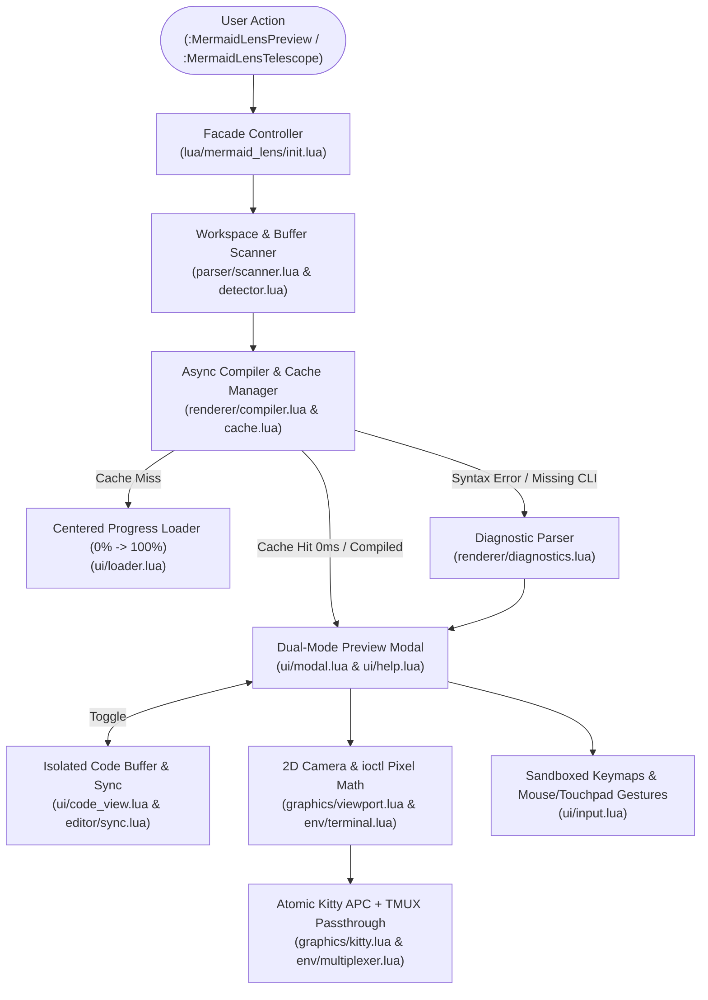

# mermaid-lens.nvim


Interactive Mermaid diagram viewer, live modal editor, and workspace finder for Neovim powered by the **Kitty Graphics Protocol**, featuring hardware-accelerated pan & zoom, mouse drag, automatic multi-palette coloring, inline syntax diagnostics, and Telescope integration.

> [!IMPORTANT]
> **Compatible Terminal Required for Graphical Rendering:** High-resolution diagram rendering requires a terminal emulator supporting the **Kitty Graphics Protocol** ([Kitty](https://sw.kovidgoyal.net/kitty/), [Ghostty](https://ghostty.org/), or [WezTerm](https://wezfurlong.org/wezterm/)) and the Mermaid CLI (`mmdc`). On unsupported terminals or when `mmdc` is missing, the modal gracefully falls back to **interactive Code Mode**.

<p align="center">
  
</p>

---

## Table of Contents

- [Quick Start (3 Steps)](#quick-start-3-steps)
- [Why `mermaid-lens.nvim`?](#why-mermaid-lensnvim)
- [Visual Features](#visual-features)
- [Commands & Interactive Controls](#commands--interactive-controls)
- [Supported Mermaid Diagrams](#supported-mermaid-diagrams)
- [Advanced Configuration](#advanced-configuration)
- [Known Limitations & Roadmap](#known-limitations--roadmap)
- [Architecture & Repository Structure](#architecture--repository-structure)

---

## Quick Start (3 Steps)

### 1. Install Mermaid CLI (`mmdc`)

```bash
npm install -g @mermaid-js/mermaid-cli
```

### 2. Add to [`lazy.nvim`](https://github.com/folke/lazy.nvim)

```lua
{
  "JuanFerber/mermaid-lens.nvim",
  dependencies = { "nvim-telescope/telescope.nvim" }, -- Optional: for workspace/buffer search
  opts = {},
}
```

### 3. Open Any Diagram

- Place your cursor on a Mermaid block in any `.md` file (or open a `.mmd` file) and press **`<leader>mp`** (`:MermaidLensPreview`).
- Press **`<leader>ms`** (`:MermaidLensTelescope`) to search all diagrams in your workspace, or **`<leader>mb`** (`:MermaidLensBuffer`) for the current file.
- Run `:checkhealth mermaid_lens` at any time to verify your terminal, `tmux`, and CLI setup.

---

## Why `mermaid-lens.nvim`?

Existing Neovim image plugins render Mermaid diagrams inline inside the text buffer grid. On real-world software architecture diagrams (`erDiagram`, `sequenceDiagram`, large `flowchart`s), inline rendering crushes labels into a few rows, lacks interactive 2D camera controls, and hides syntax errors.

`mermaid-lens.nvim` opens diagrams in a dedicated, aspect-ratio-accurate floating modal backed directly by the terminal's GPU texture memory:

- **Zero-latency hardware pan & zoom:** Uploads the high-DPI texture once and updates source crop rectangles (`x, y, w, h`) via atomic escape sequences without re-transmitting files or moving Neovim's physical cursor (`C=1`).
- **True pixel aspect-ratio adaptation:** Queries exact physical cell dimensions (`ws_xpixel / ws_col`, `ws_ypixel / ws_row`) from the host TTY via LuaJIT FFI `ioctl(TIOCGWINSZ)`—even through `tmux`—so diagrams never stretch or distort.
- **Dual-Mode Live Editing (`<Tab>`) & Isolated Undo:** Toggle seamlessly between the rendered diagram and an editable Mermaid code buffer inside the modal. Saving (`:w`) updates the exact block in your parent `.md` or `.mmd` file, re-renders only when code changes, and maintains a per-diagram isolated undo tree (`u` / `<C-r>`) that never interferes with edits outside the diagram.
- **Line-Exact Syntax Diagnostics (`vim.diagnostic`):** If `mmdc` encounters a syntax error, the modal automatically switches to Code Mode, highlights the exact offending line, and displays the parser error inline.
- **Multi-palette auto-coloring:** Automatically styles entities, actors, states, and nodes with a 10-color palette in both **Light** (Mermaid Live style, default) and **Dark** (TokyoNight style) themes.

---

## Visual Features

### 1. Light & Dark Auto-Colored Themes (`t` to toggle)

|         Light Theme (Default)          |           Dark Theme (`t`)           |
| :------------------------------------: | :----------------------------------: |
|  |  |

### 2. Project & Buffer Telescope Finder (`<leader>ms` / `<leader>mb`)


### 3. Built-in Diagnostics (`:checkhealth mermaid_lens`)


---

## Commands & Interactive Controls

### Global Commands & Default Keymaps

When using [`which-key.nvim`](https://github.com/folke/which-key.nvim), pressing `<leader>` displays **`+MermaidLens`** under `m`, with concise action labels inside the group:

| Command                                   | Default Keymap | Action Label in WhichKey      | Description                                                                         |
| :---------------------------------------- | :------------- | :---------------------------- | :---------------------------------------------------------------------------------- |
| `:MermaidLensPreview`                     | `<leader>mp`   | `Preview`                     | Render the Mermaid block under the cursor (or the current `.mmd` file).             |
| `:MermaidLensTelescope [project\|buffer]` | `<leader>ms`   | `Workspace Search`            | Open the Telescope diagram finder (workspace-wide by default).                      |
| `:MermaidLensBuffer`                      | `<leader>mb`   | `Buffer Search`               | Open the Telescope diagram finder filtered to the **current file only**.            |
| `:MermaidLensASCII`                       | `<leader>ma`   | `Preview ASCII (Coming soon)` | ASCII rendering mode (_Coming soon_).                                               |
| `:MermaidLensReload`                      | —              | —                             | Reload all plugin Lua modules in place (also runs automatically on `:Lazy update`). |

### Interactive Modal Controls

Diagrams open in **Full Overview (`1.0x`)** centered inside the modal. Press `<Tab>` at any time to toggle between **Preview Mode** (sandboxed canvas) and **Code / Edit Mode** (live Mermaid editor synced to your source `.md` or `.mmd` file).

#### Preview Mode

| Key / Gesture                  | Action                                                             |
| :----------------------------- | :----------------------------------------------------------------- |
| `<Tab>`                        | Switch to **Code / Edit Mode**                                     |
| `h` `j` `k` `l` / `Arrow Keys` | Pan camera across the diagram                                      |
| `Left Click + Drag`            | Freehand canvas pan (1:1 pixel tracking, corner-to-center freedom) |
| `+` / `=` / `-`                | Zoom in / Zoom out (anchored to viewport center)                   |
| `Mouse Wheel` / `Ctrl + Wheel` | Focal zoom in / out                                                |
| `f` / `Double Left Click`      | Toggle between **Full Overview (`1.0x`)** and **Smart Width Fit**  |
| `0` / `Right Click`            | Reset camera to centered Full Overview (`1.0x`)                    |
| `t`                            | Toggle between **Light** and **Dark** theme in real time           |
| `m`                            | Toggle 2-finger Touchpad mode between **Zoom** and **2D Pan**      |
| `r`                            | Force manual re-render                                             |
| `?`                            | Open / close the keyboard options overlay                          |
| `q` / `<Esc>`                  | Close the modal and free GPU texture memory                        |

#### Code / Edit Mode

| Key / Command | Action                                                                                     |
| :------------ | :----------------------------------------------------------------------------------------- |
| `<Tab>`       | Return to **Preview Mode** (compiles only if the code was modified)                        |
| `:w`          | Save changes back to the parent `.md` block or `.mmd` file (and re-render if modified)     |
| `u` / `<C-r>` | Undo / Redo changes exclusively within this diagram's isolated history                     |
| `?`           | Open / close the keyboard options overlay                                                  |
| `q` / `<Esc>` | Close the modal (`q` warns if there are unsaved modifications; `<Esc>` discards and quits) |

### Telescope Picker Controls

| Key            | Action                                                                                             |
| :------------- | :------------------------------------------------------------------------------------------------- |
| `<CR>` (Enter) | Compile and open the selected diagram in the interactive preview modal                             |
| `<C-g>`        | Open the source file and jump to the exact line where the diagram is defined                       |
| `<C-f>`        | Toggle live between **Workspace (`[Workspace]`)** and **Current File (`[Current File]`)** diagrams |

---

## Supported Mermaid Diagrams

| Category                    | Supported Diagram Keywords                                                                                               | Auto-Coloring Support                 |
| :-------------------------- | :----------------------------------------------------------------------------------------------------------------------- | :------------------------------------ |
| **Database & Architecture** | `erDiagram`, `classDiagram`, `C4Context`, `C4Container`, `C4Component`, `C4Dynamic`, `C4Deployment`, `architecture-beta` | Yes (10-color cyclic palette)         |
| **Flows & State**           | `flowchart`, `graph`, `stateDiagram`, `stateDiagram-v2`, `block-beta`                                                    | Yes (Nodes, clusters & states)        |
| **Interactions & Time**     | `sequenceDiagram`, `gantt`, `timeline`, `journey`, `gitGraph`                                                            | Yes (Actors, notes, tasks & branches) |
| **Data & Hierarchy**        | `mindmap`, `pie`, `quadrantChart`, `sankey`, `xychart`, `packet-beta`, `requirementDiagram`, `kanban`                    | Yes (`themeVariables` scales)         |

### Naming & Indexing Rules in Markdown

1. **Explicit Name (` ```mermaid <name> `):** Indexed in Telescope as `[Block] │ <name> │ path/to/file.md:10`.
2. **Comment Directive (`%% name: <name>`):** Supported inside standard ` ```mermaid ` blocks.
3. **Unnamed Blocks:** Automatically named after their diagram type (e.g., `erDiagram`). Multiple unnamed blocks of the same type in one file are numbered (`flowchart #1`, `flowchart #2`, etc.).
4. **Standalone `.mmd` / `.mermaid` Files:** Indexed with their filename, detected diagram type, and relative path (`[File] │ schema.mmd <erDiagram> │ path/to/schema.mmd`).

---

## Advanced Configuration

All settings are optional. Click below to view the full configuration schema and default values:

<details>
<summary><strong>Click to expand full <code>opts</code> configuration reference</strong></summary>

```lua
{
  "JuanFerber/mermaid-lens.nvim",
  dependencies = { "nvim-telescope/telescope.nvim" },
  opts = {
    -- Default rendering theme: "light" (Mermaid Live style) | "dark" (TokyoNight style)
    theme = "light",

    -- Dim the background behind the floating preview modal
    backdrop = true,
    backdrop_blend = 45, -- 0 (opaque) to 100 (fully transparent)

    -- Headless Chromium deviceScaleFactor (1..4) for crisp deep zoom
    scale = 3,

    -- Initial 2-finger touchpad behavior inside the modal: "zoom" | "pan"
    touchpad_mode = "zoom",

    -- Default Telescope search scope: "project" (all workspace files) | "buffer" (current file only)
    picker_scope = "project",

    -- Additional directories or glob patterns to ignore in Telescope workspace scans
    -- (Appended to built-in defaults: .git, node_modules, target, dist, build, .venv, etc.)
    ignored_dirs = {
      -- ".local",
      -- "docs/archive",
      -- "*.bak.md",
    },

    -- Code Mode & Live Editing options
    fallback_to_code = true,     -- Open modal in Code Mode if dependencies are missing or syntax fails
    auto_render_on_save = true,  -- Re-compile & preview on `:w` in Code Mode (only when code changed)
    save_parent_on_write = true, -- Sync edits back to the parent .md/.mmd file on `:w`

    -- Modal window geometry relative to the current terminal size
    modal = {
      width = 0.92,       -- 92% of terminal columns
      height = 0.90,      -- 90% of usable terminal rows
      border = "rounded", -- "rounded" | "single" | "double" | "solid"
    },

    -- Customizable keymaps (accepts a string, a table of strings, or `false` to disable)
    keymaps = {
      -- Global editor keymaps
      preview = "<leader>mp",
      ascii = "<leader>ma",
      search = "<leader>ms",
      search_buffer = "<leader>mb",

      -- Interactive modal keymaps
      modal = {
        toggle_code = "<Tab>",
        pan_left = { "h", "<Left>" },
        pan_right = { "l", "<Right>" },
        pan_up = { "k", "<Up>" },
        pan_down = { "j", "<Down>" },
        zoom_in = { "+", "=" },
        zoom_out = "-",
        reset = "0",
        toggle_fit = "f",
        toggle_theme = "t",
        toggle_touchpad = "m",
        rerender = "r",
        help = "?",
        quit = { "q", "<Esc>" },
      },

      -- Telescope picker keymaps
      picker = {
        jump_to_source = "<C-g>",
        toggle_scope = "<C-f>",
      },
    },
  },
}
```

</details>

### TMUX Persistence (Optional)

If you run Neovim inside `tmux`, `mermaid-lens.nvim` configures your active `tmux` server automatically at runtime. To persist these settings across `tmux` server restarts, add to `~/.tmux.conf`:

```tmux
set -g allow-passthrough all
set -g focus-events on
set -g mouse on
```

---

## Known Limitations & Roadmap

- **Terminal Emulator Support:** Graphical rendering relies on the Kitty Graphics Protocol (`a=t`, `a=p` source-crop viewports) supported by **Kitty**, **Ghostty**, and **WezTerm**. Terminals that only support Sixel or iTerm2 inline images (or plain xterm/Alacritty) will open diagrams in **Code Mode** until fallback protocols are added.
- **ASCII Rendering Mode (`Coming soon`):** `:MermaidLensASCII` (`<leader>ma`) is currently a placeholder stub and will be implemented in a future update.
- **First-Compile Latency:** The first time an uncached diagram is rendered (or modified), `mmdc` spawns headless Chromium (~0.8s–1.5s, indicated by the centered percentage loader). Subsequent opens of unchanged diagrams are served from the content-addressed disk cache in **`0ms`**.

---

## Architecture & Repository Structure



```text
lua/
├── mermaid_lens/
│   ├── init.lua              # Public facade, setup(), WhichKey group, and hot-reload
│   ├── health.lua            # :checkhealth mermaid_lens diagnostics
│   ├── config/
│   │   ├── constants.lua     # System limits, defaults, keymap schemas, and ignore rules
│   │   └── themes.lua        # 10-color Light/Dark palettes and CSS generator
│   ├── editor/
│   │   └── sync.lua          # Safe fence relocation and live .md/.mmd write synchronization
│   ├── env/
│   │   ├── multiplexer.lua   # TMUX detection, pane offsets, and DCS passthrough
│   │   └── terminal.lua      # Kitty protocol detection and LuaJIT FFI ioctl metrics
│   ├── parser/
│   │   ├── detector.lua      # Diagram type classifier and name resolver
│   │   └── scanner.lua       # Buffer extractor and workspace scanner with ignore filters
│   ├── renderer/
│   │   ├── cache.lua         # Content-addressed cache paths and PNG IHDR reader
│   │   ├── compiler.lua      # Async mmdc pipeline and progress loader coordinator
│   │   ├── diagnostics.lua   # mmdc stderr parser and vim.diagnostic publisher
│   │   └── ascii.lua         # Stub for upcoming ASCII mode
│   ├── graphics/
│   │   ├── kitty.lua         # Atomic Kitty APC escape sequences (DECSC/DECRC + C=1)
│   │   └── viewport.lua      # 2D camera projection and corner-to-center clamping
│   └── ui/
│       ├── code_view.lua     # Isolated per-diagram editable buffer and BufWriteCmd hook
│       ├── input.lua         # Buffer key sandboxing and mouse/touchpad gestures
│       ├── loader.lua        # Centered percentage progress bar modal
│       ├── help.lua          # Dynamic keyboard options overlay (?)
│       ├── modal.lua         # Dual-mode interactive preview window and backdrop
│       └── picker.lua        # Telescope workspace and buffer finder
└── telescope/
    └── _extensions/
        └── mermaid_lens.lua  # Native Telescope extension bridge
```

---

## Contributing

Contributions follow the [Conventional Commits](https://www.conventionalcommits.org/) specification and [Semantic Versioning 2.0.0](https://semver.org/).

## License

MIT
