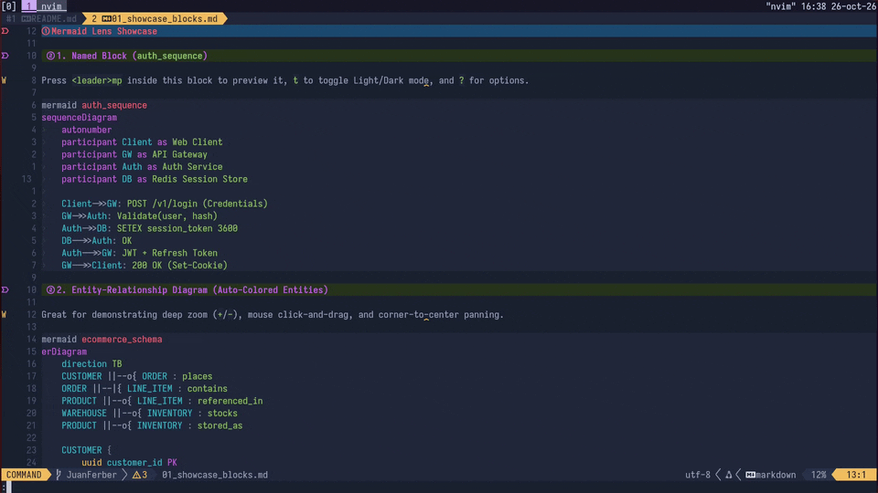
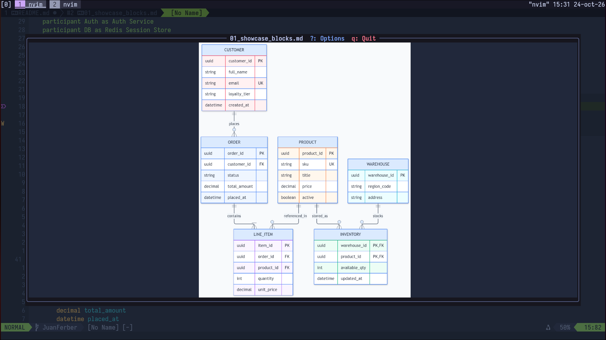
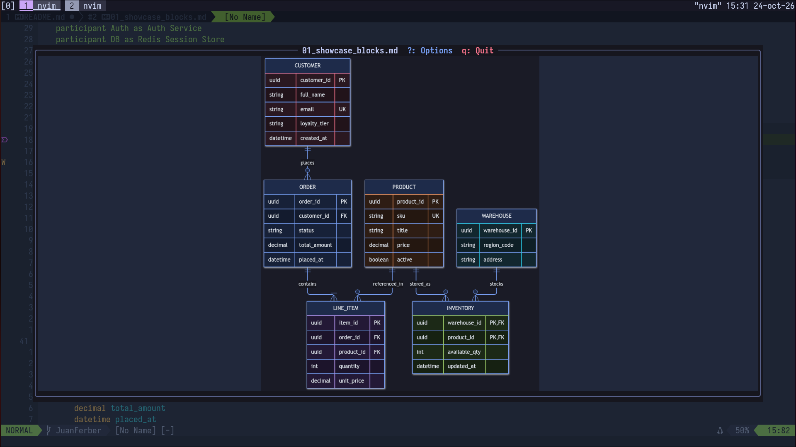
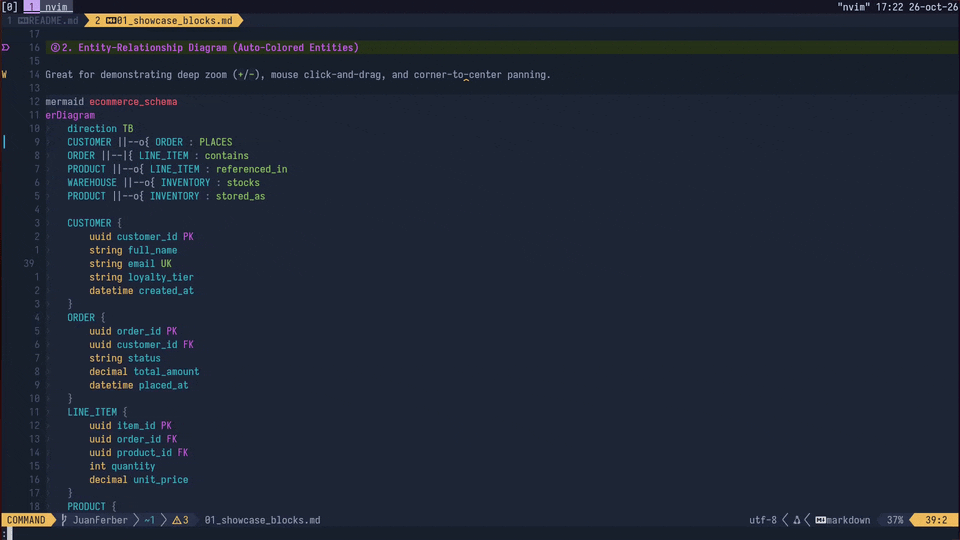
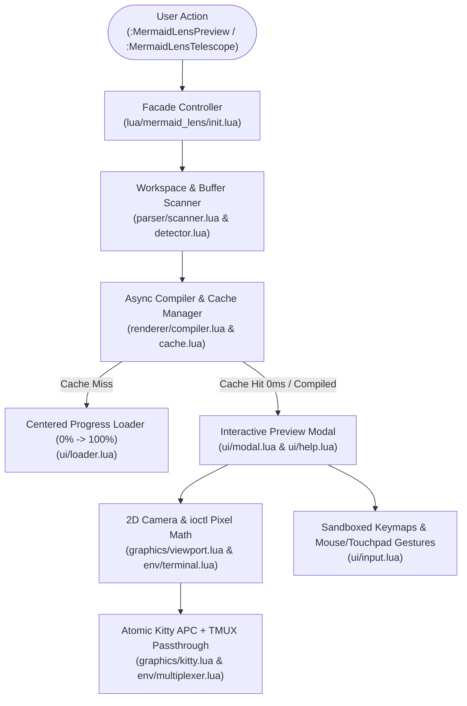
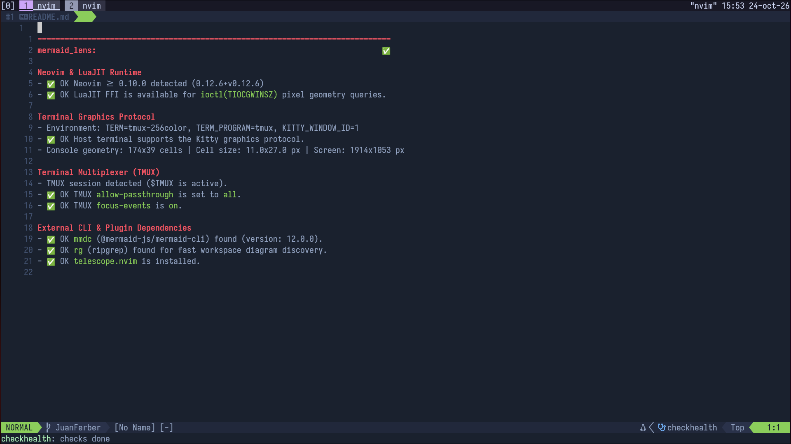

# mermaid-lens.nvim


Interactive Mermaid diagram viewer and workspace finder for Neovim powered by the **Kitty Graphics Protocol**, featuring hardware-accelerated pan & zoom, mouse drag, automatic multi-palette coloring, Light/Dark theme switching, and Telescope integration.

---

<p align="center">
  
</p>

---

## Why `mermaid-lens.nvim`?

### The Problem

Existing Neovim image plugins render Mermaid diagrams inline inside the text buffer grid. On real-world software architecture diagrams (`erDiagram`, `sequenceDiagram`, large `flowchart`s), inline buffer rendering suffers from three limitations:

1. **Unreadable scaling:** Tall or wide diagrams are crushed into a few terminal rows, making labels illegible.
2. **No interactive camera:** Static inline placements cannot be panned in 2D, dragged with the mouse, or zoomed focally at 60 FPS.
3. **No workspace discovery:** Finding a specific diagram across dozens of Markdown docs and `.mmd` files requires manual grepping.

### The Solution

`mermaid-lens.nvim` opens diagrams in a dedicated, aspect-ratio-accurate floating modal backed directly by the terminal's GPU texture memory:

- **Zero-latency hardware pan & zoom:** Uploads the high-DPI texture once and updates source crop rectangles (`x, y, w, h`) via atomic escape sequences without re-transmitting files or moving Neovim's physical cursor (`C=1`).
- **True pixel aspect-ratio adaptation:** Queries exact physical cell dimensions (`ws_xpixel / ws_col`, `ws_ypixel / ws_row`) from the host TTY via LuaJIT FFI `ioctl(TIOCGWINSZ)`—even through `tmux`—so diagrams never stretch or distort when resizing splits.
- **Corner-to-center drag freedom:** Allows dragging any of the 4 diagram corners all the way to the center of the modal for effortless inspection of edge nodes.
- **Multi-palette auto-coloring:** Automatically styles entities, actors, states, and nodes with a 10-color palette in both **Light** (Mermaid Live style, default) and **Dark** (TokyoNight style) themes.
- **Workspace-wide Telescope picker:** Scans both fenced Markdown blocks and standalone `.mmd` / `.mermaid` files across your project.

### Explicit Non-Goals

- **No inline buffer text distortion:** `mermaid-lens.nvim` never mutates buffer lines or injects virtual text spacers into your editing window.
- **No live browser server:** Everything renders inside your terminal window.
- **ASCII fallback:** Currently marked as _Coming soon_; the plugin targets terminals supporting the Kitty graphics protocol (Kitty, Ghostty, WezTerm).

---

## Visual Features

### 1. Light & Dark Auto-Colored Themes (`t` to toggle)

|         Light Theme (Default)          |           Dark Theme (`t`)           |
| :------------------------------------: | :----------------------------------: |
|  |  |

### 2. Project-Wide Telescope Finder (`<leader>ms`)

<p align="center">
  
</p>

---

## Architecture & Execution Flow



---

## Supported Mermaid Diagrams

`mermaid-lens.nvim` detects, indexes, and renders all standard Mermaid diagram syntaxes in both Markdown fenced blocks and standalone `.mmd` / `.mermaid` files:

| Category                    | Supported Diagram Keywords                                                                                               | Auto-Coloring Support                 |
| :-------------------------- | :----------------------------------------------------------------------------------------------------------------------- | :------------------------------------ |
| **Database & Architecture** | `erDiagram`, `classDiagram`, `C4Context`, `C4Container`, `C4Component`, `C4Dynamic`, `C4Deployment`, `architecture-beta` | Yes (10-color cyclic palette)         |
| **Flows & State**           | `flowchart`, `graph`, `stateDiagram`, `stateDiagram-v2`, `block-beta`                                                    | Yes (Nodes, clusters & states)        |
| **Interactions & Time**     | `sequenceDiagram`, `gantt`, `timeline`, `journey`, `gitGraph`                                                            | Yes (Actors, notes, tasks & branches) |
| **Data & Hierarchy**        | `mindmap`, `pie`, `quadrantChart`, `sankey`, `xychart`, `packet-beta`, `requirementDiagram`, `kanban`                    | Yes (`themeVariables` scales)         |

### Naming & Indexing Rules in Markdown

1. **Explicit Name (` ```mermaid <name> `):**
   ````markdown
   ```mermaid auth_flow
   sequenceDiagram
       Client->>Server: Request
   ```
   ````
   Indexed in Telescope as `[Block] │ auth_flow │ path/to/file.md:10`.
2. **Comment Directive (`%% name: <name>`):** Supported inside standard ` ```mermaid ` blocks.
3. **Unnamed Blocks:** Automatically named after their diagram type (e.g., `erDiagram`). If a file contains multiple unnamed blocks of the same type, they are automatically numbered (`flowchart #1`, `flowchart #2`, etc.).
4. **Standalone `.mmd` / `.mermaid` Files:** Indexed in Telescope with their filename, detected diagram type, and relative path (`[File] │ schema.mmd <erDiagram> │ path/to/schema.mmd`).

---

## Requirements

1. **Neovim `>= 0.10.0`** built with **LuaJIT**.
2. **Terminal Emulator** supporting the Kitty Graphics Protocol:
   - [Kitty](https://sw.kovidgoyal.net/kitty/)
   - [Ghostty](https://ghostty.org/)
   - [WezTerm](https://wezfurlong.org/wezterm/)
3. **Mermaid CLI (`mmdc`):**
   ```bash
   npm install -g @mermaid-js/mermaid-cli
   ```
4. **Optional (Recommended):**
   - [`telescope.nvim`](https://github.com/nvim-telescope/telescope.nvim) for workspace diagram search (`:MermaidLensTelescope`).
   - [`ripgrep`](https://github.com/BurntSushi/ripgrep) (`rg`) for fast project scanning.

### TMUX Configuration (If running inside `tmux`)

`mermaid-lens.nvim` automatically configures your active `tmux` server at runtime, but adding these lines to `~/.tmux.conf` is recommended for persistence:

```tmux
set -g allow-passthrough all
set -g focus-events on
set -g mouse on
```

---

## Installation & Configuration

### Using [`lazy.nvim`](https://github.com/folke/lazy.nvim)

#### Minimal Setup (Uses Defaults)

```lua
{
  "JuanFerber/mermaid-lens.nvim",
  dependencies = { "nvim-telescope/telescope.nvim" },
  opts = {},
}
```

#### Full Configuration Reference (`opts`)

All settings are optional. Below are the default values:

```lua
{
  "JuanFerber/mermaid-lens.nvim",
  dependencies = { "nvim-telescope/telescope.nvim" },
  opts = {
    -- Default rendering theme: "light" (Mermaid Live style) | "dark" (TokyoNight style)
    theme = "light",

    -- Dim the background behind the floating preview modal
    backdrop = true,
    backdrop_blend = 45, -- 0 (opaque) to 100 (fully transparent)

    -- Headless Chromium deviceScaleFactor (1..4) for crisp deep zoom
    scale = 3,

    -- Initial 2-finger touchpad behavior inside the modal: "zoom" | "pan"
    touchpad_mode = "zoom",

    -- Modal window geometry relative to the current terminal size
    modal = {
      width = 0.92,       -- 92% of terminal columns
      height = 0.90,      -- 90% of usable terminal rows
      border = "rounded", -- "rounded" | "single" | "double" | "solid"
    },

    -- Global keymaps (set `keymaps = false` or any individual key to `false` to disable)
    keymaps = {
      preview = "<leader>mp",
      ascii = "<leader>ma",
      search = "<leader>ms",
    },
  },
}
```

### Verifying Your Setup (`:checkhealth`)

Run the built-in health check at any time to verify your terminal protocol, FFI pixel metrics, `tmux` settings, and CLI dependencies:

```vim
:checkhealth mermaid_lens
```



---

## Commands & Interactive Controls

### User Commands

| Command                 | Default Keymap | Description                                                             |
| :---------------------- | :------------- | :---------------------------------------------------------------------- |
| `:MermaidLensPreview`   | `<leader>mp`   | Render the Mermaid block under the cursor (or the current `.mmd` file). |
| `:MermaidLensTelescope` | `<leader>ms`   | Open the workspace-wide Telescope diagram finder.                       |
| `:MermaidLensASCII`     | `<leader>ma`   | ASCII rendering mode (_Coming soon_).                                   |

### Interactive Modal Controls

The preview modal sandboxes all standard Vim editing operators so you never accidentally trigger visual/insert/operator-pending modes while navigating a diagram.

| Key / Gesture                  | Action                                                                       |
| :----------------------------- | :--------------------------------------------------------------------------- |
| `h` `j` `k` `l` / `Arrow Keys` | Pan camera across the diagram                                                |
| `Left Click + Drag`            | Freehand canvas pan (1:1 pixel tracking)                                     |
| `+` / `=` / `-`                | Zoom in / Zoom out (anchored to viewport center)                             |
| `Mouse Wheel` / `Ctrl + Wheel` | Focal zoom in / out                                                          |
| `f` / `Double Left Click`      | Toggle between **Smart Fit** (readable width) and **Full Overview** (`1.0x`) |
| `0` / `Right Click`            | Reset camera to initial Smart Fit position                                   |
| `t`                            | Toggle between **Light** and **Dark** theme in real time                     |
| `m`                            | Toggle 2-finger Touchpad mode between **Zoom** and **2D Pan**                |
| `?`                            | Open / close the keyboard options overlay                                    |
| `q` / `<Esc>`                  | Close the modal and free GPU texture memory                                  |

### Telescope Picker Controls

| Key            | Action                                                                       |
| :------------- | :--------------------------------------------------------------------------- |
| `<CR>` (Enter) | Compile and open the selected diagram in the interactive preview modal       |
| `<C-g>`        | Open the source file and jump to the exact line where the diagram is defined |

---

## Repository Structure

```text
lua/
├── mermaid_lens/
│   ├── init.lua              # Public facade, setup(), commands, and keymaps
│   ├── health.lua            # :checkhealth mermaid_lens diagnostics
│   ├── config/
│   │   ├── constants.lua     # System limits, defaults, and Mermaid syntax patterns
│   │   └── themes.lua        # 10-color Light/Dark palettes and CSS generator
│   ├── env/
│   │   ├── multiplexer.lua   # TMUX detection, pane offsets, and DCS passthrough
│   │   └── terminal.lua      # Kitty protocol detection and LuaJIT FFI ioctl metrics
│   ├── parser/
│   │   ├── detector.lua      # Diagram type classifier and name resolver
│   │   └── scanner.lua       # Buffer extractor and workspace file scanner
│   ├── renderer/
│   │   ├── cache.lua         # Content-addressed cache paths and PNG IHDR reader
│   │   ├── compiler.lua      # Async mmdc pipeline and progress loader coordinator
│   │   └── ascii.lua         # Stub for upcoming ASCII mode
│   ├── graphics/
│   │   ├── kitty.lua         # Atomic Kitty APC escape sequences (DECSC/DECRC + C=1)
│   │   └── viewport.lua      # 2D camera projection and corner-to-center clamping
│   └── ui/
│       ├── input.lua         # Buffer key sandboxing and mouse/touchpad gestures
│       ├── loader.lua        # Centered percentage progress bar modal
│       ├── help.lua          # Keyboard options overlay (?)
│       ├── modal.lua         # Main interactive preview window and backdrop
│       └── picker.lua        # Telescope workspace finder
└── telescope/
    └── _extensions/
        └── mermaid_lens.lua  # Native Telescope extension bridge
```

---

## Contributing

Contributions follow the [Conventional Commits](https://www.conventionalcommits.org/) specification and [Semantic Versioning 2.0.0](https://semver.org/).

## License

MIT
