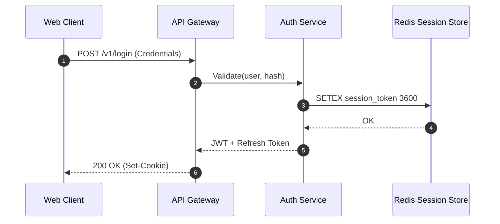
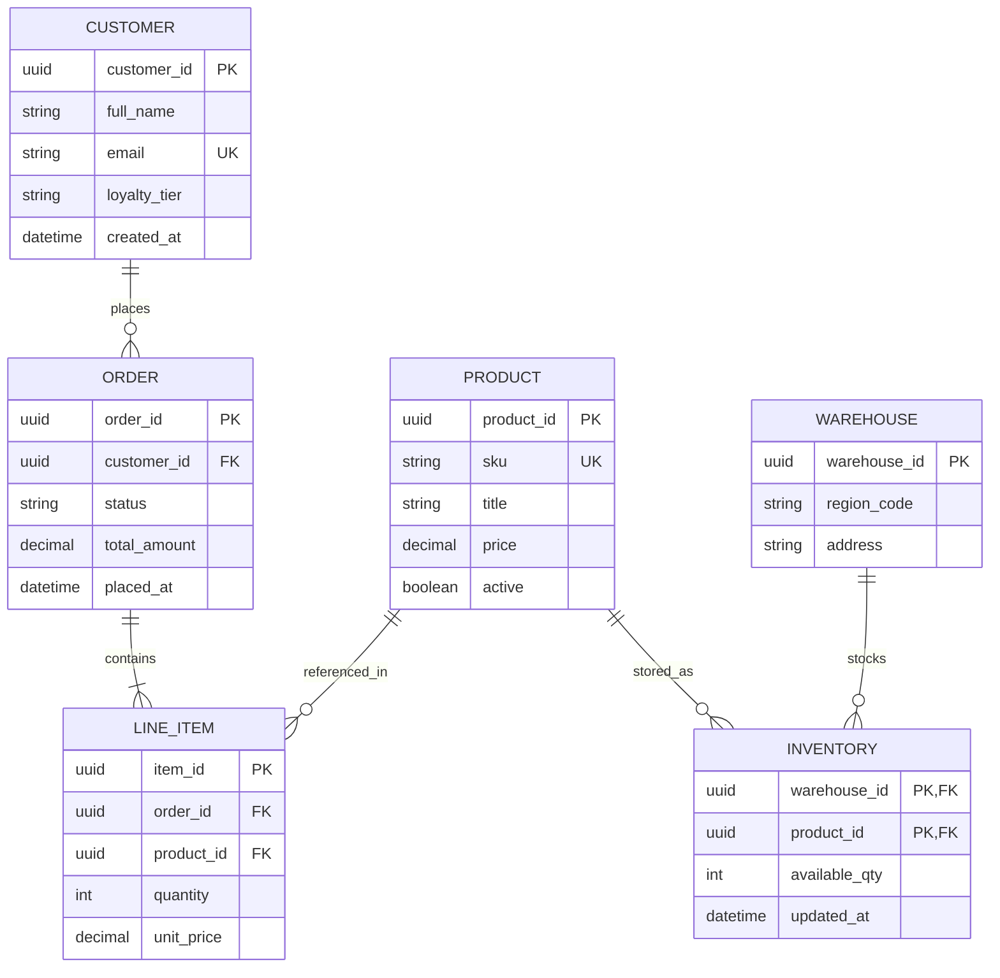
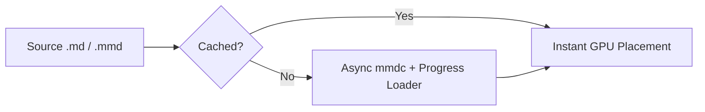
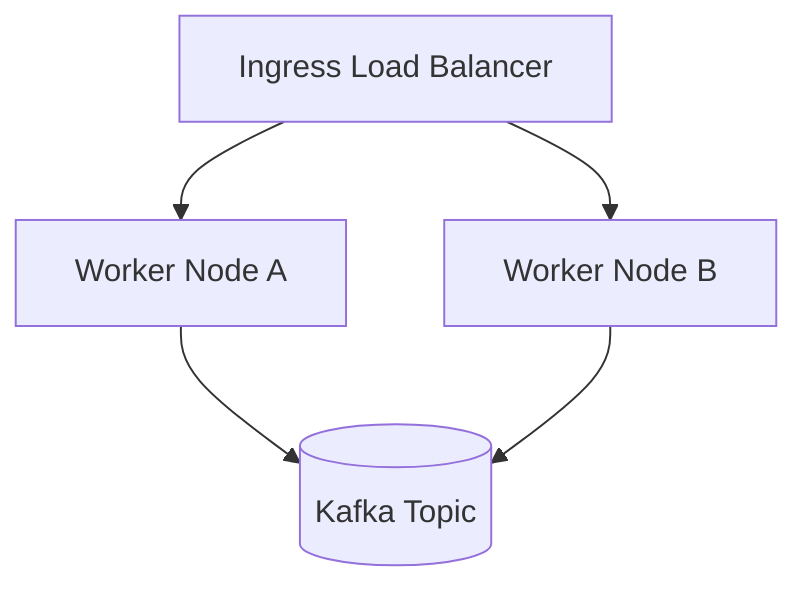
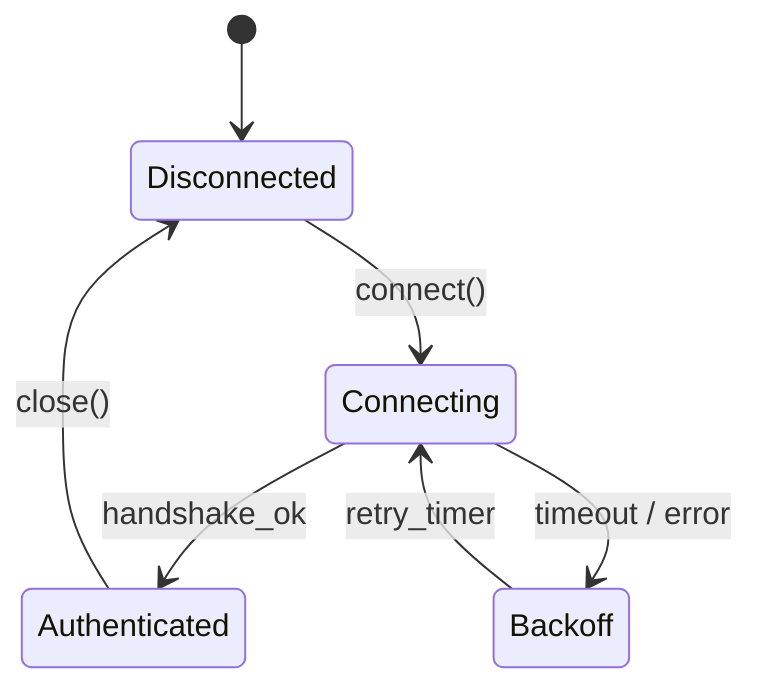

# Mermaid Lens Showcase

## 1. Named Block (`auth_sequence`)

Press `<leader>mp` inside this block to preview it, `t` to toggle Light/Dark mode, and `?` for options.

## 2. Entity-Relationship Diagram (Auto-Colored Entities)

Great for demonstrating deep zoom (`+`/`-`), mouse click-and-drag, and corner-to-center panning.

## 3. Unnamed Blocks (Auto-Numbered in Telescope as `flowchart #1` & `flowchart #2`)

## 4. State Machine

